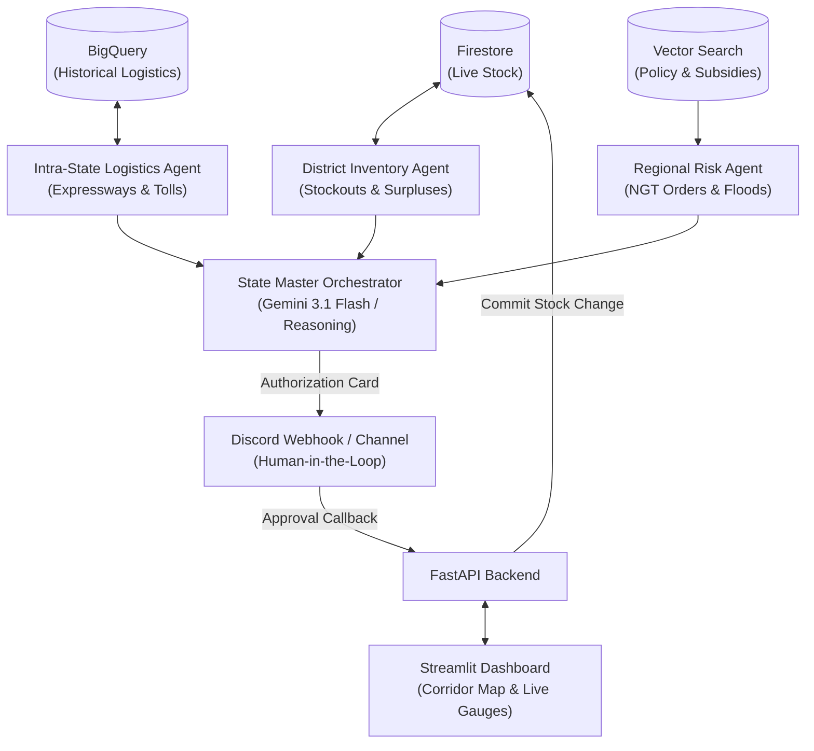

# TAN-IX (Tannery Intelligent eXchange)
### State-Level Multi-Agent Supply Chain Risk & Inventory Manager for Leather Goods
**Focus Region: Uttar Pradesh Leather Clusters (Kanpur, Unnao, Agra, Noida)**

---

## 🌟 1. Project Overview & Real-World Domain Context

Uttar Pradesh is the heart of India's leather and footwear economy, driven by four distinct yet highly interdependent industrial clusters:

1. **Kanpur (Jajmau Hub)**: Heavy tanning, saddlery, and industrial leather. Located along the Ganges River, Kanpur is acutely sensitive to monsoon floods and stringent **National Green Tribunal (NGT)** environmental effluent limits.
2. **Unnao (Banthar Leather Complex)**: Raw hides to wet-blue and crust processing. Acts as the primary raw tanning feed for downstream manufacturing.
3. **Agra (Sikandra & Hing Ki Mandi)**: India's premier footwear manufacturing cluster. Consumes millions of square feet of finished leather and shoe uppers from Kanpur and Unnao.
4. **Noida / Greater Noida (Sector 63/65 Export Hub)**: Luxury fashion garments, designer handbags, and premium export accessories with strict international flight and port dispatch schedules.

### Transit Lifelines:
- **Agra-Lucknow Expressway & NH-19**: Connects Kanpur/Unnao to Agra (~285 km, 4.5 hrs).
- **Yamuna Expressway**: Connects Agra to Greater Noida/Noida (~195 km, 2.5 hrs).

---

## 🤖 2. Multi-Agent Architecture

TAN-IX features **4 Autonomous Specialist Agents** coordinating in real-time:



1. **District Inventory Agent**:
   - Continuously monitors stock of raw hides, crust leather, shoe soles, and export garments across warehouses.
   - Detects critical shortages and matches them against clusters with excess surplus buffer.
2. **Intra-State Logistics Agent**:
   - Computes highway routing along the Agra-Lucknow and Yamuna Expressways.
   - Evaluates toll charges, freight vehicles (Tata 407, Eicher Pro), and historical delay factors (winter fog, bridge traffic).
3. **Regional Risk Agent**:
   - Monitors NGT environmental effluent shutdown notices, Ganges river flood warnings, and raw hide price spikes.
   - Uses Vector Search to cite UP ODOP (One District One Product) freight subsidies.
4. **State Master Orchestrator (Human-in-the-Loop)**:
   - Synthesizes findings from all 3 specialist agents.
   - Proposes emergency rebalance plans and posts high-priority approval cards to **Discord**.
   - Commits inventory transfers only upon verified human approval.

---

## 🛠️ 3. Technology Stack

- **Language**: Python 3.10+
- **LLM Reasoning**: Google GenAI / Gemini 3.1 Flash (`google-genai`)
- **Live Database**: Google Cloud Firestore (with local seed fallback)
- **Analytical Data Warehouse**: Google Cloud BigQuery (historical transit logs)
- **Semantic Policy RAG**: Vector Search (over UP Leather & NGT guidelines)
- **Backend Microservice**: FastAPI & Uvicorn
- **Frontend Dashboard**: Streamlit & Pydeck (3D Geospatial Corridor Map)
- **Human-in-the-Loop**: Discord Webhook & Interactive REST Callback
- **Cloud Deployment**: Google Cloud Run (Containerized via Docker)

---

## 🚀 4. Quickstart Guide (Beginner Friendly!)

### Step 1: Set up Virtual Environment (Windows PowerShell)
Open your terminal in `c:\Users\ERMOH\Desktop\TAN-IX`:
```powershell
python -m venv venv
.\venv\Scripts\Activate.ps1
```

### Step 2: Install Dependencies
```powershell
pip install -r requirements.txt
```

### Step 3: Configure Environment Variables
Copy the `.env.example` file to `.env`:
```powershell
cp .env.example .env
```
Open `.env` in any text editor:
- Paste your free Gemini API key from [Google AI Studio](https://aistudio.google.com/).
- (Optional) Paste a Discord Webhook URL if you want alerts sent directly to your Discord channel.
- If you don't have Google Cloud Firestore or BigQuery accounts yet, **leave `USE_MOCK_DATA=true`**. The system will run completely offline with pre-seeded realistic data!

### Step 4: Run the Streamlit Dashboard
```powershell
streamlit run dashboard/app.py
```
Your browser will open automatically at `http://localhost:8501`.

### Step 5: (Optional) Run the FastAPI Backend
In a separate terminal window:
```powershell
uvicorn api.main:app --reload --port 8000
```
API Documentation and interactive swagger UI will be available at `http://localhost:8000/docs`.

---

## 🎭 5. Capstone Demo Walkthrough

1. **Inspect Live Corridor Map**:
   - Open `http://localhost:8501`.
   - View the 3D Pydeck map showing Kanpur $\rightarrow$ Unnao $\rightarrow$ Agra $\rightarrow$ Noida.
   - Notice that **Agra** and **Noida** have critical leather inventory shortages!
2. **Inject a Simulated Emergency**:
   - In the sidebar, click **"🌊 Ganges Basin Flood Warning (Kanpur)"** or **"📜 NGT Effluent Inspection Shutdown"**.
   - Notice the risk score for Kanpur instantly jumps to Critical (85/100).
3. **Trigger Multi-Agent Reasoning**:
   - Switch to the **"🤖 Multi-Agent Orchestrator & Deliberation"** tab.
   - Click **"🚀 Trigger Full State Multi-Agent Assessment"**.
   - Watch the 3 specialist agents collaborate:
     - Inventory Agent flags the deficit in Agra.
     - Risk Agent highlights the impending NGT shutdown in Kanpur.
     - Logistics Agent plots the fastest transit along the Agra-Lucknow Expressway (~4.5 hrs, ₹18,500).
     - Vector Search checks and applies the **15% UP ODOP Freight Subsidy**.
4. **Human-in-the-Loop Authorization**:
   - An approval card will appear in both the dashboard and your Discord channel.
   - Click **"✅ AUTHORIZE STOCK REBALANCE"**.
   - The stock is instantly transferred from Kanpur's surplus warehouse to Agra's footwear hub, resolving the crisis!

---

## ☁️ 6. Cloud Run Deployment

To deploy this project directly to Google Cloud Run:
```bash
# Authenticate with Google Cloud
gcloud auth login
gcloud config set project YOUR_PROJECT_ID

# Build and deploy the container
gcloud run deploy tan-ix \
    --source . \
    --platform managed \
    --region asia-south1 \
    --allow-unauthenticated
```
