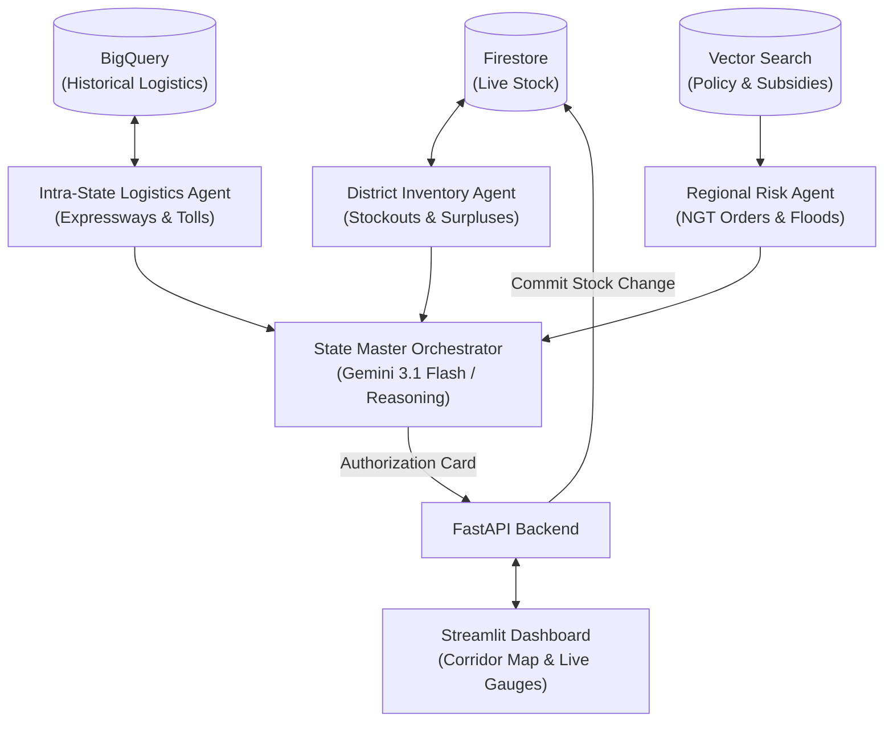

# AgentHide

### State-Level Multi-Agent Supply Chain Risk & Inventory Manager for Leather Goods

**Focus Region: Uttar Pradesh Leather Clusters (Kanpur, Unnao, Agra, Noida)**

---

## 🌟 1. Project Overview & Real-World Domain Context

Uttar Pradesh is the heart of India's leather and footwear economy, driven by four distinct yet highly interdependent industrial clusters:

1. **Kanpur (Jajmau Hub)**: Heavy tanning, saddlery, and industrial leather. Located along the Ganges River, Kanpur is acutely sensitive to monsoon floods and stringent **National Green Tribunal (NGT)** environmental effluent limits.
2. **Unnao (Banthar Leather Complex)**: Raw hides to wet-blue and crust processing. Acts as the primary raw tanning feed for downstream manufacturing.
3. **Agra (Sikandra & Hing Ki Mandi)**: India's premier footwear manufacturing cluster. Consumes millions of square feet of finished leather and shoe uppers from Kanpur and Unnao.
4. **Noida / Greater Noida (Sector 63/65 Export Hub)**: Luxury fashion garments, designer handbags, and premium export accessories with strict international flight and port dispatch schedules.

### Transit Lifelines:

* **Agra-Lucknow Expressway & NH-19**: Connects Kanpur/Unnao to Agra (~285 km, 4.5 hrs).
* **Yamuna Expressway**: Connects Agra to Greater Noida/Noida (~195 km, 2.5 hrs).

---

## 🤖 2. Multi-Agent Architecture

AgentHide features **4 Autonomous Specialist Agents** coordinating in real-time:

1. **District Inventory Agent**:
* Continuously monitors stock of raw hides, crust leather, shoe soles, and export garments across warehouses.
* Detects critical shortages and matches them against clusters with excess surplus buffer.

2. **Intra-State Logistics Agent**:
* Computes highway routing along the Agra-Lucknow and Yamuna Expressways.
* Evaluates toll charges, freight vehicles (Tata 407, Eicher Pro), and historical delay factors (winter fog, bridge traffic).

3. **Regional Risk Agent**:
* Monitors NGT environmental effluent shutdown notices, Ganges river flood warnings, and raw hide price spikes.
* Uses Vector Search to cite UP ODOP (One District One Product) freight subsidies.

4. **State Master Orchestrator (Human-in-the-Loop)**:
* Synthesizes findings from all 3 specialist agents.
* Proposes emergency rebalance plans and requests operational authorization.
* Commits inventory transfers only upon verified administrative approval.

---

## 🛠️ 3. Technology Stack

* **Language**: Python 3.10+
* **LLM Reasoning**: Google GenAI / Gemini 3.1 Flash (`google-genai`)
* **Live Database**: Google Cloud Firestore (with local seed fallback)
* **Analytical Data Warehouse**: Google Cloud BigQuery (historical transit logs)
* **Semantic Policy RAG**: Vector Search (over UP Leather & NGT guidelines)
* **Backend Microservice**: FastAPI & Uvicorn
* **Frontend Dashboard**: Streamlit & Pydeck (3D Geospatial Corridor Map)