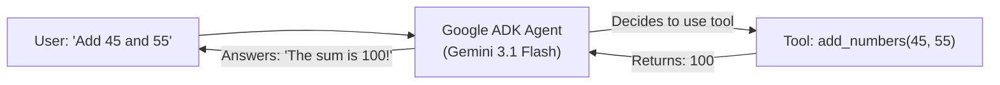

# 🎓 Beginner's Guide: Google ADK (Agent Development Kit)

This guide explains the foundational concepts of the **Google Agent Development Kit (ADK)** using our practice agent in [`agents/hello_agent`](file:///c:/Users/ERMOH/Desktop/TAN-IX/agents/hello_agent).

---

## 💡 1. The Three Core Concepts (In Plain English)

### 1. What is an Instruction? (The Goal & Personality)
* **Analogy:** A detailed job description given to a new employee on day one.
* **Why it matters:** An LLM without instructions is just a generic text completer. The instruction tells the AI:
  * **Who it is:** *"You are HelloMathAgent, a friendly AI tutor."*
  * **What rules it must follow:** *"Always be encouraging and brief."*
  * **How to use tools:** *"Whenever asked to add numbers, you MUST call the `add_numbers` tool."*

### 2. What is a Tool? (The Hands & Calculator)
* **Analogy:** A calculator or wrench given to a human worker.
* **Why it matters:** Large Language Models predict likely text, but they can make arithmetic mistakes or hallucinate information.
* **How it works:** A tool is just a standard Python function with type hints and a docstring:
  ```python
  def add_numbers(a: float, b: float) -> float:
      """Adds two numbers together and returns the exact sum."""
      return a + b
  ```
  The Gemini model reads the docstring, automatically generates arguments `{"a": 45, "b": 55}`, calls your Python function, and gets the exact mathematical result (`100.0`).

### 3. What is an Agent? (The Autonomous Coordinator)
* **Analogy:** A skilled project manager who has a brain (Gemini), a goal (Instructions), and tools (Python functions).
* **Why it matters:** An Agent ties all three pieces together into an autonomous decision loop:
  1. **Hears** the user's question: *"What is 45 plus 55?"*
  2. **Reasons:** *"I have a tool called `add_numbers`. I will call it with `a=45` and `b=55`."*
  3. **Executes:** Runs the Python tool and receives `100.0`.
  4. **Responds:** *"45 plus 55 is exactly 100!"*



---

## 🚀 2. How to Run with the ADK CLI & Dev Web UI

Make sure your virtual environment is active in PowerShell:
```powershell
.\venv\Scripts\Activate.ps1
```

### Method 1: Run the Standalone Runner Script
```powershell
python agents/hello_agent/run_agent.py
```
*Inspects the agent's instructions, registered tools, and tests the function directly.*

### Method 2: Ask a Single Question via the ADK CLI
```powershell
python -m google.adk.cli run agents/hello_agent "What is 350 plus 475?" --in_memory
```

### Method 3: Start an Interactive Terminal Chat
```powershell
python -m google.adk.cli run agents/hello_agent --in_memory
```
*Allows you to chat back-and-forth with the agent directly in your PowerShell terminal.*

### Method 4: Launch the ADK Web Dev UI
Google ADK includes a full visual browser interface with an agent playground and tool call inspector:
```powershell
python -m google.adk.cli web agents
```
1. Open the URL displayed in the terminal (e.g. `http://localhost:8000`).
2. Select **`hello_agent`** from the left sidebar.
3. Type *"What is 150 + 850?"* in the chat box.
4. You will see Gemini autonomously trigger the **`add_numbers`** tool and display the step-by-step reasoning trace!
