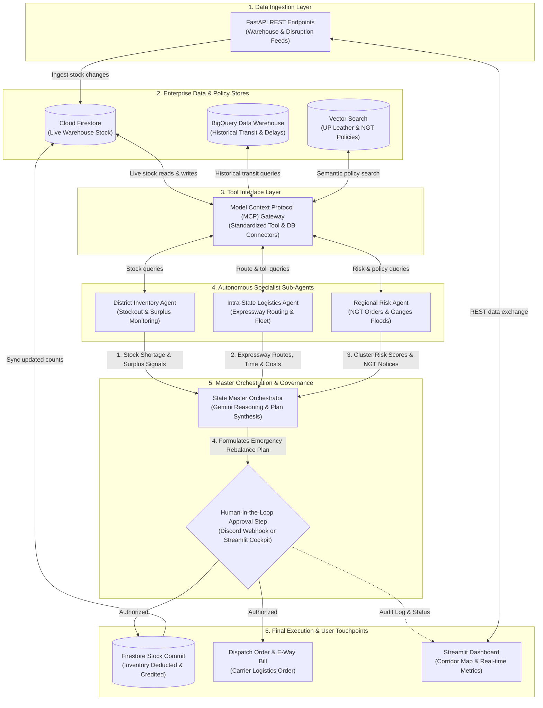

# 🏛️ System Architecture: TAN-IX
### State-Level Multi-Agent Supply Chain Risk & Inventory Manager for UP Leather Goods

---

## 📊 End-to-End System Architecture Diagram

---

## 📦 Component Explanations (Box-by-Box)

1. **FastAPI REST Endpoints**: Ingests external stock updates, receives simulated disruption triggers, and handles approval webhook callbacks.
2. **Cloud Firestore**: Stores live, real-time warehouse inventory counts, item units, and safety threshold limits for Kanpur, Unnao, and Agra.
3. **BigQuery Data Warehouse**: Stores and analyzes historical shipment logs, expressway transit times, carrier reliability, and seasonal delay trends.
4. **Vector Search (Policy RAG)**: Performs semantic searches across UP Industrial Leather policies, NGT environmental mandates, and ODOP freight subsidy rules.
5. **Model Context Protocol (MCP) Gateway**: Serves as the standardized, secure tool layer that connects agents to databases, route calculators, and policy search tools.
6. **District Inventory Agent**: Continuously scans warehouse inventory to detect critical shortages in Agra and find matching surplus buffers in Kanpur or Unnao.
7. **Intra-State Logistics Agent**: Calculates optimal highway paths along the Agra-Lucknow Expressway, estimating transit duration, toll fees, and vehicle capacity.
8. **Regional Risk Agent**: Monitors Ganges basin flood warnings and NGT environmental shutdown notices to calculate a composite cluster vulnerability score.
9. **State Master Orchestrator**: Uses Gemini reasoning to synthesize reports from all three specialist sub-agents and formulate an emergency stock transfer plan.
10. **Human-in-the-Loop Approval Step**: Halts automated inventory changes until a human supervisor clicks "Approve" or "Reject" via Discord or the web dashboard.
11. **Firestore Stock Commit**: Automatically updates live database quantities (deducting donor cluster stock and crediting recipient cluster stock) upon human authorization.
12. **Dispatch Order & E-Way Bill**: Generates formal freight dispatch documentation, vehicle assignments, and route manifests for truck drivers.
13. **Streamlit Dashboard**: Provides a visual control room featuring a 3D corridor map, warehouse stock progress bars, and live agent conversation logs.
