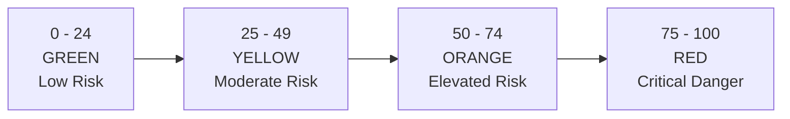

# Highway Corridor Risk Scoring Guide
**Project:** TAN-IX (Uttar Pradesh Leather Supply Chain Multi-Agent System)  
**Corridors:** Kanpur $\leftrightarrow$ Unnao $\leftrightarrow$ Agra $\leftrightarrow$ Noida

---

## 1. What is a Corridor Risk Score?

Imagine you are driving a truck full of finished leather shoes from Kanpur to Agra. Before you leave, you want to know:
> *"Is the highway safe, or are we going to get stuck in a flood, dense fog, or a police blockade?"*

In **TAN-IX**, every highway route lane (like `LANE-03` for the Agra-Lucknow Expressway or `LANE-11` for the Yamuna Expressway) has a **Risk Score** between **0 and 100**:
- **0** means: *Clear roads, sunny skies, zero delays. Safe to drive!*
- **100** means: *Severe disaster, highway flooded or completely shut down. Do not enter!*

This score is calculated automatically by the **Regional Risk Agent** and **Logistics Agent** whenever an incident happens.

---

## 2. The 3 Simple Ingredients of the Formula

We do not use complicated mystery math. The formula combines **3 common-sense factors** that any logistics dispatcher looks at:

$$\text{Total Risk Score} = \min(100, \, \text{Severity Points} + \text{Duration Points} + \text{Shipment Points})$$

```
+--------------------------------------------------------------------------+
|                        TOTAL RISK SCORE (0 - 100)                        |
+--------------------------------------------------------------------------+
|  1. Severity Points  |  2. Duration Points    |  3. Shipment Points     |
|     (0 to 40 pts)    |     (0 to 30 pts)      |     (0 to 30 pts)       |
|  "How bad is it?"    |  "How long will it     |  "How many trucks       |
|                      |   last?"               |   are stuck?"           |
+--------------------------------------------------------------------------+
```

---

### Factor 1: Severity — "How bad is the event?" (0 to 40 Points)

Different disruptions have different danger levels. We assign points based on severity:

| Severity Level | Points | What it Means in Real Life | Real UP Example |
| :--- | :---: | :--- | :--- |
| **NONE** | **0** | No disruption. Normal driving conditions. | Standard sunny day dispatch. |
| **LOW** | **10** | Minor slowdown, easily managed. | Routine toll booth RFID glitch. |
| **MEDIUM** | **20** | Noticeable delay, partial lane slowdown. | Planned bio-filter maintenance at CETP. |
| **HIGH** | **30** | Major obstruction or legal shutdown. | Dense winter fog on Yamuna Expway (visibility < 40m). |
| **CRITICAL** | **40** | Total road closure, disaster, or flood. | Ganges River monsoon overflow submerging bridge ramps. |

---

### Factor 2: Duration — "How long will it last?" (0 to 30 Points)

A 2-hour delay is annoying, but a 3-day road closure can shut down an entire shoe factory.

- We award **10 points for every day** the disruption is expected to continue.
- The maximum score for duration is **30 points** (reached after 3 days).

$$\text{Duration Points} = \min(30, \, \text{Disruption Duration in Days} \times 10)$$

| Duration | Calculation | Duration Points |
| :--- | :--- | :---: |
| **12 Hours (0.5 Days)** | $0.5 \times 10$ | **5 pts** |
| **1 Day (24 Hours)** | $1.0 \times 10$ | **10 pts** |
| **2 Days (48 Hours)** | $2.0 \times 10$ | **20 pts** |
| **3 Days (72 Hours)** | $3.0 \times 10$ | **30 pts** *(Maximum cap)* |
| **5 Days** | $5.0 \times 10 \rightarrow \text{capped}$ | **30 pts** |

---

### Factor 3: Shipment Exposure — "How many trucks are in harm's way?" (0 to 30 Points)

If only 1 truck uses a quiet rural road, the risk to the overall state supply chain is small. But if 15 freight trucks carrying ₹1.5 Crore worth of export leather jackets are headed straight toward a roadblock, the crisis is huge!

- We award **2 points for every shipment** delayed or traveling on that corridor.
- The maximum score for exposure is **30 points** (reached at 15 or more shipments).

$$\text{Shipment Exposure Points} = \min(30, \, \text{Exposed Shipments} \times 2)$$

| Shipments at Risk | Calculation | Shipment Points |
| :--- | :--- | :---: |
| **2 Shipments** | $2 \times 2$ | **4 pts** |
| **5 Shipments** | $5 \times 2$ | **10 pts** |
| **10 Shipments** | $10 \times 2$ | **20 pts** |
| **15+ Shipments** | $15 \times 2 \rightarrow \text{capped}$ | **30 pts** *(Maximum cap)* |

---

## 3. The Risk Thermometer: What Does the Score Mean?



| Score Range | Alert Level | What Dispatchers & Autonomous Agents Do |
| :---: | :---: | :--- |
| **0 – 24** | 🟢 **LOW** | **All Clear:** Normal operations. Lowest-cost commercial carrier selected. |
| **25 – 49** | 🟡 **MODERATE** | **Caution:** Minor delays expected. Keep monitoring GPS trackers. |
| **50 – 74** | 🟠 **ELEVATED** | **Warning:** Reroute urgent consignments. Consider switching to secondary highways. |
| **75 – 100** | 🔴 **CRITICAL** | **Corridor Blocked:** Autonomous reroute triggered immediately (`LANE-ALT`), or pause dispatches. |

---

## 4. Real-World Step-by-Step Examples

### Scenario 1: Dense Fog on the Yamuna Expressway (`LANE-11`)
- **Incident:** Dense winter fog near Jewar, visibility under 40 meters (`EVT-AGR-01`).
- **Severity:** `HIGH` $\rightarrow$ **30 points**
- **Duration:** Estimated 2 days (night speed limits) $\rightarrow 2 \times 10 =$ **20 points**
- **Shipments at Risk:** 6 scheduled trucks between Agra and Noida $\rightarrow 6 \times 2 =$ **12 points**

$$\text{Risk Score} = 30 + 20 + 12 = \mathbf{62.0} \quad (\text{ELEVATED RISK})$$
*Action:* Autonomous agent alerts dispatchers and slows speed limits to 50 km/h.

---

### Scenario 2: Ganges River Flood Submerging Ganga Bridge Ramp (`LANE-01`)
- **Incident:** Narora Barrage high water discharge causing waterlogging on access ramps at Shuklaganj (`EVT-KNP-02`).
- **Severity:** `CRITICAL` $\rightarrow$ **40 points**
- **Duration:** Estimated 3.5 days flood crest $\rightarrow 3.5 \times 10 = 35 \rightarrow$ **30 points (capped)**
- **Shipments at Risk:** 16 trucks moving between Kanpur tanneries and Unnao hubs $\rightarrow 16 \times 2 = 32 \rightarrow$ **30 points (capped)**

$$\text{Risk Score} = 40 + 30 + 30 = \mathbf{100.0} \quad (\text{MAXIMUM CRITICAL DANGER})$$
*Action:* Corridor is marked blocked. Freight rerouted or held at hub warehouses.

---

### Scenario 3: Normal Dispatch on NH-19 Alternative (`LANE-03-ALT`)
- **Incident:** None. The arterial highway via Etawah is clear.
- **Severity:** `NONE` $\rightarrow$ **0 points**
- **Duration:** 0 days $\rightarrow$ **0 points**
- **Shipments at Risk:** 0 delayed $\rightarrow$ **0 points**

$$\text{Risk Score} = 0 + 0 + 0 = \mathbf{0.0} \quad (\text{ZERO RISK})$$
*Action:* Route is fully open for freight traffic.

---

## 5. Estimating Impact: How `estimate_impact(lane_id)` Works

When a lane is degraded, logistics managers need answers to two concrete questions:
1. **How many shipments will be delayed?**
2. **How many days of delay are we facing?**

`estimate_impact(lane_id)` returns a clear JSON dictionary:

```json
{
  "lane_id": "LANE-11",
  "route_name": "Yamuna Expressway",
  "shipments_delayed": 7,
  "delay_in_days": 2.0,
  "severity": "HIGH",
  "disruption_id": "EVT-AGR-01",
  "disruption_title": "Dense Winter Fog Night Speed Restrictions",
  "estimated_cost_inr": 30800.0,
  "summary": "Lane LANE-11 (Yamuna Expressway) is degraded: 7 shipments delayed by approx. 2.0 days due to Dense Winter Fog Night Speed Restrictions [HIGH Severity]. Est. cost impact: INR 30,800.00."
}
```

The estimated financial penalty is calculated from standard freight holding and driver idling costs:
$$\text{Cost Impact (INR)} = \text{Shipments Delayed} \times \text{Delay in Days} \times \text{₹2,200 / day}$$

---

## 6. Python Usage Quick Reference

```python
from tools.risk_tools import (
    get_active_disruptions,
    lanes_affected_by,
    calculate_lane_risk_score,
    estimate_impact
)

# 1. Fetch active disruptions
disruptions = get_active_disruptions()
print(f"Active events: {len(disruptions)}")

# 2. Check which lanes are hit by an incident
fog_lanes = lanes_affected_by("EVT-AGR-01")
print(f"Lanes affected by fog: {fog_lanes}")
# Output: ['LANE-11', 'LANE-12']

# 3. Compute the risk score (0 - 100)
score = calculate_lane_risk_score("LANE-11")
print(f"LANE-11 Risk Score: {score}/100")

# 4. Estimate operational impact
impact = estimate_impact("LANE-11")
print(f"Delayed Shipments: {impact['shipments_delayed']}")
print(f"Delay in Days: {impact['delay_in_days']}")
```
